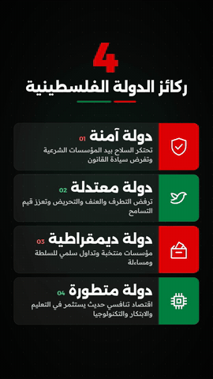
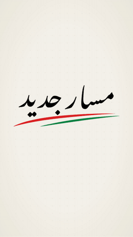

# Masar Jadid — Party Vision (motion graphics in code)

> فيديو موشن جرافيك لرؤية حزب «مسار جديد» — 13 مشهد، مبني بالكامل بالكود.

<p align="center"> &nbsp; </p>

A 3-page Arabic vision document turned into a **2:34 vertical explainer (13 scenes)** and a **41-second social cut**.
No stock footage: every shape, icon, transition and note of music is generated by code.

**Watch:** [portfolio](https://suliman-hasanien.github.io/portfolio/#work)

## Highlights
- **Logo that writes itself** — `work/split_logo.py` separates the client's logo into calligraphy / red stroke / green stroke layers (colour-to-alpha + hue masks), which are revealed one after another.
- **Kinetic Arabic typography** — per-word rise/blur/scale animation (`Words` in `src/kit.tsx`) with RTL-correct layout.
- **Hand-built visuals** — stroke-drawn line icons (`src/icons.tsx`), a parliament built from pillars, a line drawing of the Dome of the Rock, a schematic two-state map, a growth chart, network graphs.
- **One timeline drives picture *and* sound** — `src/timeline.json` (100 BPM, 1 beat = 18 frames) defines scenes, moods and transitions; `work/make_music.py` reads the same file and synthesizes an original score (pads, keys, bass, drums, whooshes, impacts) so every cut lands on the beat.
- **Two cuts, one codebase** — `MasarJadid` (full) and `MasarJadidShort` (intro → tagline → four pillars → outro) share all scenes.

## Stack
Remotion 4 · React 18 · TypeScript · SVG · Python (NumPy, Pillow) · FFmpeg

## Structure
```
remotion/src/
  timeline.json     scene order, length (bars), music mood, transition — full + short cut
  theme.ts          brand colours (sampled from the logo), fonts, scene timing
  kit.tsx           motion primitives: Words, Swoosh, Heading, Card, Drift, Reveal, Sheen …
  icons.tsx         line icons drawn with stroke-dash animation
  scenes1-3.tsx     the 13 scenes
  Video.tsx         sequencing, zoom-through on cuts, band / iris / split transitions
work/make_music.py  original score generated from timeline.json
work/split_logo.py  logo → transparent layers
```

## Run
```bash
cd remotion
npm install
npx remotion studio src/index.ts                       # preview
python ../work/make_music.py src/timeline.json public/music.wav
python ../work/make_music.py src/timeline.json public/music_short.wav short
npx remotion render src/index.ts MasarJadid out/full.mp4 --crf=16
npx remotion render src/index.ts MasarJadidShort out/short.mp4 --crf=16
```
Then loudness-normalise for social: `ffmpeg -i out/full.mp4 -c:v copy -af loudnorm=I=-14:TP=-1.5 -c:a aac final.mp4`

---
Built by **Suliman Hasanien** with an AI-assisted workflow (Claude Code).
The Masar Jadid name and logo belong to the client and are included only to reproduce this project. Fonts: Alexandria & Readex Pro (SIL OFL).
